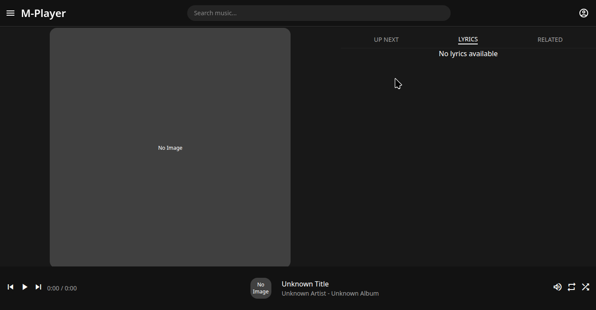

# M-Player

A desktop music player built with Electron, React and Vite, inspired by the YouTube Music experience (this is not a fork; the UI was recreated from scratch using the reference below).



## What it does today
- Select and load local audio files (mp3/flac/ogg/m4a) from a native dialog.
- Reads metadata, embedded artwork and lyrics via `music-metadata`.
- Plays a queue with play/pause, previous/next, seek bar, shuffle/repeat, volume and mute.
- Persists queue, playback settings and per-track position across sessions.
- Responsive UI that mirrors YouTube Music: navbar with search, collapsible sidebar, artwork view, tabs (Up Next / Lyrics / Related), and a bottom transport bar.

## Roadmap / future ideas
- Media keys support and global shortcuts.
- Library view with folders/playlists and search over the indexed files.
- Mini player mode and richer Now Playing on mobile.
- Better error toasts and retry when a file is missing.
- Equalizer and crossfade.

## Contributing / feedback
I'm new to React (coming from other frameworks), so if you spot bugs or have improvements, please open an issue describing the problem/idea. PRs are welcome once discussed.

## Setup

```sh
# clone the project
git clone https://github.com/IgnacioVeiga/M-Player.git

# enter the project directory
cd M-Player

# install dependency
npm install

# develop
npm run dev

# build executable
npm run build
```

## Directory structure

```tree
├── electron                                 Electron-related code
│   ├── main                                 Main-process source code
│   └── preload                              Preload-scripts source code
│
├── release                                  Generated after production build
│   └── {version}
│       ├── {os}-{os_arch}                   Contains unpacked application
│       └── {app_name}_{version}.{ext}       Installer for the application
│
├── public                                   Static assets
└── src                                      Renderer source code (React)
```

## Reference

Based on the Electron + Vite + React template: [Electron Vite React Repository](https://github.com/electron-vite/electron-vite-react/)
